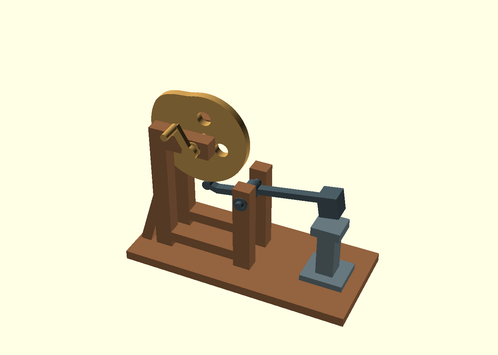

# Inspected cam hammer images — 12 September 2026

Copyright (C) 2026 Luis Henrique Cassis Fagundes. AGPL-3.0-only.

Unedited OpenSCAD snapshots of this gallery's original CAD. The selected
isometric view shows lift at 120°; the shaft-axis view shows release at
250°, including the now-visible rounded shoe, open contact, pivot and
hammer/anvil alignment. No museum images are included.

From the gallery root, using the installed environment:

```sh
SOLID_BUILD_DIR=_build/cam_hammer machinome snapshot cam_hammer -o _evidence/cam-hammer-isometric.png --autocenter --viewall --time 0.333333333 --imgsize 1400x1000
SOLID_BUILD_DIR=_build/cam_hammer machinome snapshot cam_hammer -o _evidence/cam-hammer-side.png --autocenter --viewall --camera 0,0,0,90,0,0,600 --time 0.694444444 --imgsize 1400x1000
```




These images show presentation and assembly. The
[validation record](../validation.md) supplies the contact, clearance,
capture, mutation and browser evidence; pixels do not prove engagement.
